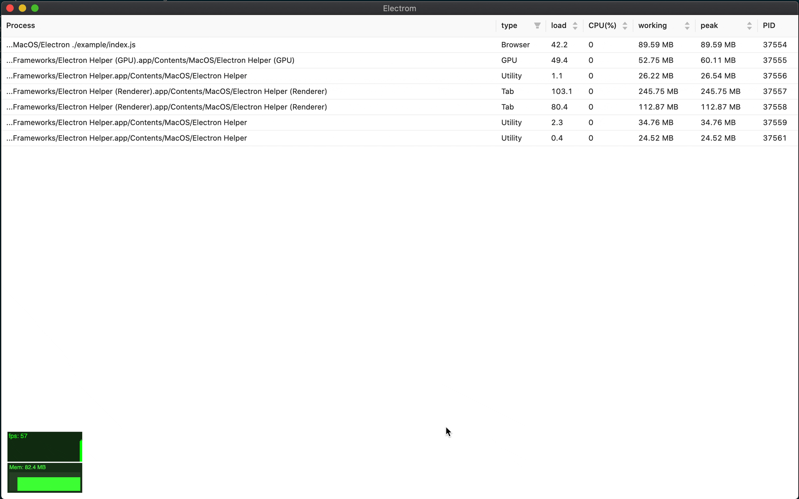

# electrom

[![NPM version][npm-image]][npm-url]
[![CI][CI-image]][CI-url]
[![Test coverage][codecov-image]][codecov-url]
[![node version][node-image]][node-url]
[![npm download][download-image]][download-url]

[npm-image]: https://img.shields.io/npm/v/electrom.svg
[npm-url]: https://npmjs.org/package/electrom
[CI-image]: https://github.com/electron-modules/electrom/actions/workflows/ci.yml/badge.svg
[CI-url]: https://github.com/electron-modules/electrom/actions/workflows/ci.yml
[codecov-image]: https://img.shields.io/codecov/c/github/electron-modules/electrom.svg?logo=codecov
[codecov-url]: https://codecov.io/gh/electron-modules/electrom
[node-image]: https://img.shields.io/badge/node.js-%3E=_8-green.svg
[node-url]: http://nodejs.org/download/
[download-image]: https://img.shields.io/npm/dm/electrom.svg
[download-url]: https://npmjs.org/package/electrom

<p align="center"></p>

> Electrom is a resource management solution for Electron applications, which is convenient for performance inspection and friendly debugging of multiple webContents.

## Installation

```bash
$ npm i electrom --save
```

## How It Works

Electrom consists of three parts:

1. **Main process (`Monitor`)** — collects CPU/memory metrics from all Electron processes at a configurable interval and emits data events.
2. **Preload script (`BROWSER_WINDOW_PRELOAD_PATH`)** — a built-in preload script that bridges IPC between main and renderer. Must be set as `webPreferences.preload` on your `BrowserWindow`.
3. **Renderer UI** — a built-in HTML dashboard (`BROWSER_WINDOW_ASSETS_PATH`) or an embeddable React component (`PerfBoard`) you can mount in your own frontend.

## Integration Guide

### Step 1 — Open a dedicated monitor window (Recommended)

This is the simplest approach: electrom provides a fully built dashboard page you can load directly into a `BrowserWindow`.

```typescript
// main process
const { BrowserWindow } = require('electron');
const { Monitor, BROWSER_WINDOW_PRELOAD_PATH, BROWSER_WINDOW_ASSETS_PATH, EVENT_DATA_CHANNEL_NAME } = require('electrom');

module.exports = (app) => {
  // 1. Create the monitor instance (default polling interval: 5000ms)
  const monitor = new Monitor();

  // 2. Create a dedicated BrowserWindow for the dashboard
  //    IMPORTANT: set the built-in preload script here
  const win = new BrowserWindow({
    width: 1280,
    height: 600,
    webPreferences: {
      preload: BROWSER_WINDOW_PRELOAD_PATH,
    },
  });

  // 3. Load the built-in dashboard UI
  win.loadURL(BROWSER_WINDOW_ASSETS_PATH);

  // 4. Start monitoring after the page is ready
  win.webContents.on('dom-ready', () => {
    // Forward metrics data from main process to the renderer
    monitor.removeAllListeners(EVENT_DATA_CHANNEL_NAME);
    monitor.on(EVENT_DATA_CHANNEL_NAME, (data) => {
      if (win && !win.isDestroyed() && win.webContents && !win.webContents.isDestroyed()) {
        win.webContents.send(EVENT_DATA_CHANNEL_NAME, data);
      }
    });
    // Allow the dashboard to send actions back (open DevTools, kill process, etc.)
    monitor.bindEventToWindow(win);
    monitor.start();
  });

  win.once('ready-to-show', () => win.show());
};
```

> **Full example:** [example/main.ts](./example/main.ts) · [electron-modules-sample/src/electrom.ts](https://github.com/electron-modules/electron-modules-sample/blob/main/src/electrom.ts)

---

### Step 2 — Embed the monitor into your existing main window

If you prefer to show metrics inside your own page instead of a separate window, forward the data channel to your main window:

```typescript
import { Monitor, EVENT_DATA_CHANNEL_NAME, BROWSER_WINDOW_PRELOAD_PATH } from 'electrom';

// Your existing BrowserWindow must also use the preload script
const mainWindow = new BrowserWindow({
  webPreferences: {
    preload: BROWSER_WINDOW_PRELOAD_PATH,
  },
});

const monitor = new Monitor();

mainWindow.webContents.on('dom-ready', () => {
  monitor.on(EVENT_DATA_CHANNEL_NAME, (data) => {
    mainWindow.webContents.send(EVENT_DATA_CHANNEL_NAME, data);
  });
  monitor.bindEventToWindow(mainWindow);
  monitor.start();
});
```

---

### Monitor options

```typescript
const monitor = new Monitor({
  threshold: 5000, // polling interval in ms (default: 5000)
  dumpDir: null, // directory to write JSON snapshots; null = disabled
  dumpThreshold: 10000, // minimum interval between snapshot writes in ms (default: 10000)
});
```

To change options after construction:

```typescript
monitor.setOptions({ dumpDir: '/tmp/electrom-dumps' });
```

---

### Exported constants

| Constant                      | Description                                                                     |
| ----------------------------- | ------------------------------------------------------------------------------- |
| `BROWSER_WINDOW_PRELOAD_PATH` | Absolute path to the built-in preload script. Use as `webPreferences.preload`.  |
| `BROWSER_WINDOW_ASSETS_PATH`  | `file://` URL of the built-in dashboard HTML page. Use with `win.loadURL(...)`. |
| `EVENT_DATA_CHANNEL_NAME`     | IPC channel name for metrics data (`'electrom:monitor:data'`).                  |
| `EVENT_ACTION_CHANNEL_NAME`   | IPC channel name for UI actions (`'electrom:monitor:action'`).                  |

---

## PerfBoard — Embed FPS & memory stats in your renderer

`PerfBoard` is a standalone React component that shows an FPS counter and memory usage overlay directly inside your own renderer page. It does **not** require a separate window.

```tsx
import React from 'react';
import PerfBoard from 'electrom/src/PerfBoard';

export default function App() {
  return (
    <div style={{ position: 'relative' }}>
      {/* PerfBoard overlays itself at the top-left corner */}
      <PerfBoard />
      {/* ...the rest of your app */}
    </div>
  );
}
```

---

## PerfTracing — Chrome tracing dumps

`PerfTracing` uses Electron's `contentTracing` API to continuously capture Chromium performance traces and write them as `.json` files. The files can be opened in `chrome://tracing` or Perfetto.

```typescript
import { PerfTracing } from 'electrom';

// Call once in app 'ready'. It loops automatically.
PerfTracing({
  dumpTargetDir: path.join(process.cwd(), '.electrom'), // where to write trace files
  partitionThreshold: 30_000, // ms per trace segment (default: 10000)
  memoryDumpConfig: {
    triggers: [{ mode: 'light', periodic_interval_ms: 10_000 }],
  },
});
```

---

## Offline Reporter

If you enabled `dumpDir` on the `Monitor`, you can post-process the collected JSON snapshots into a human-readable report:

```typescript
import { pickDataFromDir, genTextReporter, renderHtmlReporter } from 'electrom';

const data = pickDataFromDir('/tmp/electrom-dumps');

// Plain-text summary (avg/max/min CPU & memory per process)
const { str } = genTextReporter(data);
console.log(str);

// HTML report — write to a file and open in a browser
import fs from 'fs';
fs.writeFileSync('report.html', renderHtmlReporter(data));
```

---

## TODO

- [ ] heapdump

## License

The MIT License (MIT)

<!-- GITCONTRIBUTOR_START -->

## Contributors

| [<br/><sub><b>xudafeng</b></sub>](https://github.com/xudafeng)<br/> | [<br/><sub><b>yantze</b></sub>](https://github.com/yantze)<br/> | [<br/><sub><b>z0gSh1u</b></sub>](https://github.com/z0gSh1u)<br/> | [<br/><sub><b>sriting</b></sub>](https://github.com/sriting)<br/> | [<br/><sub><b>snapre</b></sub>](https://github.com/snapre)<br/> | [<br/><sub><b>WynterDing</b></sub>](https://github.com/WynterDing)<br/> |
| :------------------------------------------------------------------------------------------------------------------------------------------------: | :--------------------------------------------------------------------------------------------------------------------------------------------: | :-----------------------------------------------------------------------------------------------------------------------------------------------: | :-----------------------------------------------------------------------------------------------------------------------------------------------: | :---------------------------------------------------------------------------------------------------------------------------------------------: | :-----------------------------------------------------------------------------------------------------------------------------------------------------: |

This project follows the git-contributor [spec](https://github.com/xudafeng/git-contributor), auto updated at `Thu Jun 05 2025 11:33:16 GMT+0800`.

<!-- GITCONTRIBUTOR_END -->
